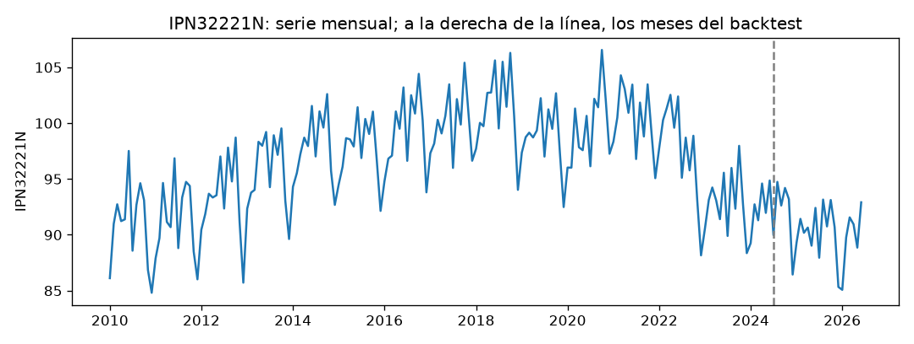
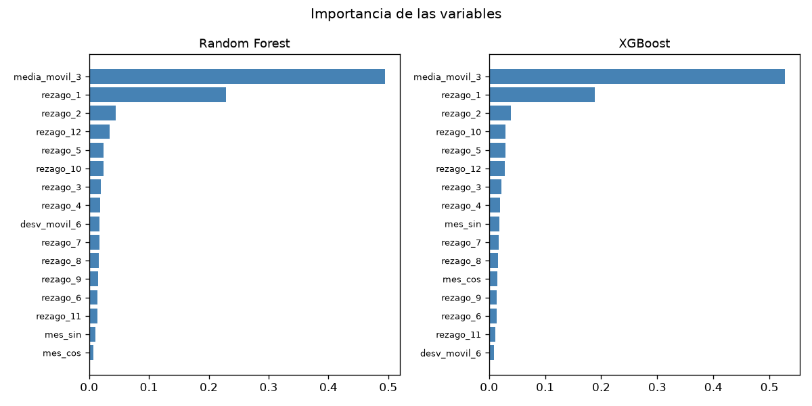
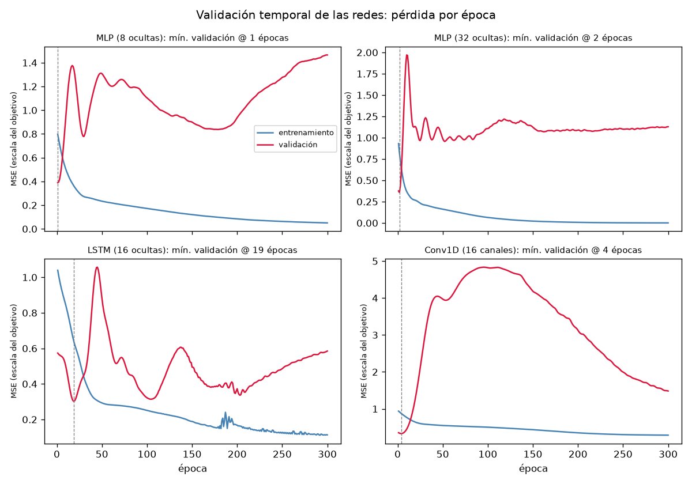
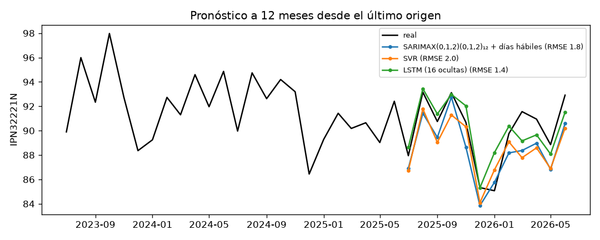

# Informe del miniproyecto 2

Serie **IPN32221N** — Índice de producción industrial de fabricación de cajas
de cartón corrugado y fibra sólida (EE. UU.). Las cifras y figuras de este
informe son las que imprime y genera `python miniproyecto.py`.

## Cómo se comparan todos los modelos

Antes de cada paso conviene fijar la **regla de medición**, porque es la misma
para todos los modelos del informe —el clásico, los cuatro de aprendizaje
automático y las tres redes— y es lo que hace que las cifras sean comparables.
Esa regla vive en `comun.py` y **no se modifica**.

**El *backtest* (origen móvil).** En lugar de medir el error una sola vez, se
imita cómo se habría usado el modelo mes a mes en el pasado reciente. Se apartan
los **últimos 24 meses** como zona de prueba y se recorren **13 orígenes**
consecutivos. En cada origen el modelo se entrena **solo con los meses
anteriores** a ese punto y pronostica los **12 meses siguientes** (horizonte 1 a
12); como nada posterior al origen entra al entrenamiento, el modelo nunca "ve el
futuro". El error de los 13 orígenes se promedia, así la cifra final no depende
de un mes afortunado. Cada modelo se entrega como una función
`modelo(entrenamiento, h)` que el *backtest* llama; ese es el único contrato que
hay que cumplir para entrar en la comparación.

**Las métricas.** Comparando cada pronóstico con lo que de verdad ocurrió se
calculan tres, todas donde **más bajo es mejor**:

- **RMSE** (raíz del error cuadrático medio): castiga más los errores grandes; es
  la métrica principal por la que se ordena la tabla final.
- **MAE** (error absoluto medio): el error típico, en las unidades del índice.
- **MAPE** (error porcentual absoluto medio): el mismo error pero en porcentaje,
  para leerlo sin pensar en la escala.

La **fila de referencia** es el mejor modelo clásico del miniproyecto 1. La
pregunta de todo el miniproyecto es si algún modelo de aprendizaje automático o
profundo lo mejora **de forma fiable** bajo esta misma regla.

## 1. La serie y el modelo a superar

La serie mide el **índice de producción industrial de la fabricación de cajas de
cartón corrugado y fibra sólida** en EE. UU. (NAICS 32221), base 2017 = 100 y
sin ajuste estacional, que publica la Reserva Federal en FRED con el código
[IPN32221N](https://fred.stlouisfed.org/series/IPN32221N). Es **mensual**, va de
**2010-01 a 2026-06** con **198 observaciones** y no tiene meses vacíos. La
preparación es la misma del miniproyecto 1: no hay huecos que rellenar y los
atípicos —dos episodios económicos reales, el desplome de la COVID (abr–jun
2020) y el rebote post-pandemia (feb–jun 2022)— se **winsorizan** recortando al
límite, sin borrar meses, los puntos cuyo residuo de una STL robusta (periodo
12) se sale de la banda $`[Q_1 - 3\,IQR,\; Q_3 + 3\,IQR] = [-2{,}58,\; +2{,}64]`$.
Se winsorizan **16 puntos**, los mismos del miniproyecto 1.

El mejor modelo clásico del miniproyecto 1 es el **SARIMAX(0,1,2)(0,1,2)₁₂ con
los días hábiles del mes como exógena**. Con $z_t$ de media cero, su ecuación es

$$y_t = \beta\,\text{(días hábiles)}_t + \eta_t,\qquad
(1-B)(1-B^{12})\,\eta_t = (1+\theta_1 B+\theta_2 B^2)\,(1+\Theta_1 B^{12}+\Theta_2 B^{24})\,\varepsilon_t,$$

es decir, una diferencia regular y una estacional ($d=1,\,D=1$), una media móvil
regular de orden 2 y una estacional de orden 2. En este *backtest* da

| Modelo | RMSE | MAE | MAPE (%) |
|---|---|---|---|
| SARIMAX(0,1,2)(0,1,2)₁₂ + días hábiles | **1.63** | 1.37 | 1.51 |

idénticas a las del miniproyecto 1. **Una diferencia de implementación, sin
efecto en las cifras:** el miniproyecto 2 solo admite `numpy`, `pandas`,
`matplotlib`, `statsmodels`, `scikit-learn`, `xgboost` y `torch`, así que la
exógena ya no usa la librería `holidays`; los días hábiles (lunes a viernes
menos festivos federales de EE. UU.) se recalculan por sus reglas en Python puro
(`_festivos_eeuu`). Esa función **reproduce exactamente** el conteo mensual de
días hábiles de `holidays.US()` sobre todo el rango (0 meses de diferencia), por
lo que el RMSE coincide al centésimo con el del miniproyecto 1. El estacional
ingenuo (RMSE 2.17) es el piso.

## 2. La tabla supervisada

Los modelos de aprendizaje automático y las redes no entienden "una serie" como
tal: aprenden de una **tabla** en la que cada fila asocia unas variables de
entrada ($X$) con el valor a predecir ($y$). El paso previo, entonces, es
convertir la serie en esa tabla —un proceso llamado *conversión supervisada*—
cuidando que **ninguna fila use información posterior al mes que predice**.

Cada fila $t$ de la tabla tiene **16 columnas**, todas construidas para no ver el
mes que predice:

- **Rezagos 1 a 12** del objetivo: $`\text{rezago}_k(t) = z_{t-k}`$, con
  $k=1,\dots,12$ (`z.shift(k)`). Cubren un año completo de historia.
- **El mes del año, cíclico** (`mes_sin`, `mes_cos`): $\sin(2\pi m_t/12)$ y
  $\cos(2\pi m_t/12)$, con $m_t$ el número de mes, para que
  diciembre quede junto a enero.
- **Dos ventanas móviles** sobre el objetivo corrido un mes (`media_movil_3`, `desv_movil_6`):
  $`\tfrac{1}{3}\sum_{j=1}^{3} z_{t-j}`$ y
  $`\mathrm{sd}(z_{t-1},\dots,z_{t-6})`$.

Los modelos **no aprenden el nivel sino la diferencia con el mismo mes del año
anterior** (`OBJETIVO = "dif12"`): $`z_t = y_t - y_{t-12} = (1-B^{12})\,y_t`$. Se
elige así porque la serie tiene tendencia y una estacionalidad fuerte (fuerza
estacional $F_s = 0{,}87$ en el miniproyecto 1); al restar $y_{t-12}$ se quita
casi toda la tendencia y la estacionalidad y el objetivo queda **casi
estacionario**, que es lo que KNN, SVR y los árboles extrapolan bien. Sobre el
nivel, en cambio, esos modelos no saben extrapolar una tendencia creciente. El
pronóstico se devuelve al nivel con $`\hat y_t = y_{t-12} + \hat z_t`$.

**Prueba de que ninguna fila ve el mes que predice.** `comprobar_sin_fuga` altera
el valor de cada mes con un cambio grande ($+100$) y verifica que la fila de la
tabla de **ese** mes no cambie: si cambiara, estaría usando $y_t$ —directa o a
través de $z_t$— para predecir $y_t$. El guion imprime
`Sin fuga: 174 filas revisadas, ninguna cambia al alterar el mes que predice`.
Funciona porque todos los rezagos son $z_{t-k}$ con $k\ge 1$ y las ventanas se
calculan sobre `z.shift(1)`, es decir hasta el mes anterior.

**Pronóstico recursivo a 12 meses.** En cada paso `recursivo` agrega el mes
siguiente como `NaN`, arma su fila con la tabla, pronostica el objetivo, lo
lleva al nivel con $`\hat y_t = y_{t-12}+\hat z_t`$ y lo **escribe como si fuera
dato** antes de pasar al mes siguiente; así cada pronóstico entra como rezago del
mes que sigue. **El escalador vive dentro de cada modelo** (`StandardScaler` en
el *pipeline* de KNN y SVR, y la estandarización de $X$ y $z$ dentro de la clase
`Red`), y `con_tabla` ajusta un modelo nuevo en cada origen del *backtest*, de
modo que el escalador se ajusta **solo con el entrenamiento de ese origen**.

## 3. Aprendizaje automático

Sobre la tabla anterior se prueban cuatro modelos clásicos de ML: **KNN**
(predice promediando los vecinos más parecidos), **SVR** (una regresión de
margen que tolera errores pequeños), **Random Forest** (un conjunto de árboles de
decisión promediados) y **XGBoost** (árboles que corrigen uno a uno el error del
anterior). Cada uno tiene **hiperparámetros** —ajustes que no se aprenden solos—
que hay que fijar.

Los hiperparámetros se eligen con `GridSearchCV` (prueba todas las combinaciones
de una rejilla) y `TimeSeriesSplit` (5 cortes)
sobre la tabla armada con `serie.iloc[:-24]`, es decir **solo con los meses
anteriores al *backtest***: cada corte entrena con el pasado y valida con el
tramo siguiente, nunca al revés, y **ninguno de los 24 meses del *backtest*
participa en la elección**. Las rejillas y lo elegido:

| Modelo | Rejilla | Elegido | RMSE val. |
|---|---|---|---|
| KNN | `n_neighbors` ∈ {3,5,10,15} | `n_neighbors=5` | 2.29 |
| SVR | `C` ∈ {1,10,100}, `epsilon` ∈ {0.05,0.1,0.2} | `C=1, epsilon=0.05` | 2.62 |
| Random Forest | `max_depth` ∈ {None,3,5,10}, `min_samples_leaf` ∈ {1,2,4} | `max_depth=10, min_samples_leaf=1` | 2.24 |
| XGBoost | `max_depth` ∈ {2,3,4}, `learning_rate` ∈ {0.05,0.1,0.2} | `max_depth=2, learning_rate=0.2` | 2.51 |

Random Forest y XGBoost coinciden: la variable que más pesa es **`media_movil_3`**
(≈ 0,5 de la importancia), seguida de **`rezago_1`** (≈ 0,2); después, con pesos
pequeños, aparecen `rezago_2` y **`rezago_12`**, el rezago estacional. Esto es
coherente con la PACF del miniproyecto 1, que marcaba rezagos significativos en
**1 y 12**: los ensambles también apoyan el pronóstico en el último mes y en el
mismo mes del año anterior. El mes del año (`mes_sin`, `mes_cos`) casi no pesa,
porque trabajar sobre `dif12` ya absorbió la estacionalidad.

En el *backtest*, entre los cuatro gana el **SVR** (RMSE 2.02), seguido de
Random Forest (2.04); XGBoost (2.70) y KNN (2.76) quedan por debajo del
estacional ingenuo (2.17). Ninguno alcanza al clásico.

## 4. Aprendizaje profundo

Se entrenan tres redes en PyTorch, cada una con una forma distinta de mirar los
12 rezagos: el **MLP** (red densa) los toma como 16 valores sueltos; la **LSTM**
los recorre como una secuencia en el tiempo, guardando memoria de lo que vio; y
la **Conv1D** desliza un filtro a lo largo de la secuencia para detectar
patrones locales. Todas con semilla fija y con $X$ y $z$ escalados con el
entrenamiento de cada origen:

| Red | Entrada | Parámetros |
|---|---|---|
| **MLP** (32 ocultas) | 16 columnas sueltas | 577 |
| **LSTM** (16 ocultas) | secuencia $(lote, 12, 1)$ | 1 233 |
| **Conv1D** (16 canales) | secuencia $(lote, 12, 1)$ | 81 |

La tercera red es una **Conv1D**: una convolución 1D (núcleo 3) sobre la
secuencia de los 12 rezagos, ReLU, un promedio global sobre el tiempo y una capa
lineal. Se eligió frente a un Transformer o un híbrido porque, con solo ~170
filas por origen, una red convolucional pequeña aprovecha los datos sin
sobreajustar y entra limpia en el mismo mecanismo de secuencia que la LSTM. La
tasa de aprendizaje se bajó a $0{,}005$ (con $0{,}01$ el MLP de pleno lote
divergía en algunos orígenes) y se recorta la norma del gradiente como segundo
seguro.

Las curvas de validación muestran el problema central de la serie: con pocos
datos, **las redes densas sobreajustan casi de inmediato**. El MLP de 8 y el de
32 ocultas tocan su mínimo de validación en la **época 1–2** y de ahí la pérdida
de validación sube mientras la de entrenamiento sigue bajando a cero; se elige el
**MLP de 32 ocultas** (menor pérdida de validación) con **2 épocas**. La **LSTM**,
en cambio, tiene un mínimo de validación real en la **época 19**, y la **Conv1D**
en la **época 4**. En el *backtest*:

| Red | RMSE |
|---|---|
| LSTM (16 ocultas), 19 épocas | 1.75 |
| Conv1D (16 canales), 4 épocas | 1.98 |
| MLP (32 ocultas), 2 épocas | 2.51 |

La **LSTM es la mejor red** y la mejor de todo el aprendizaje automático y
profundo, aunque no supera al clásico. Repetida con **cinco semillas**, cada una
por el *backtest*:

| Semilla | 2026 | 2027 | 2028 | 2029 | 2030 | **media** | **desv** |
|---|---|---|---|---|---|---|---|
| RMSE | 1.747 | 1.963 | 1.889 | 1.500 | 1.914 | **1.803** | **0.187** |

El dato clave: la distancia entre la LSTM (media 1,80) y el clásico (1,63) es
**$0{,}17$**, **menor que la desviación $0{,}19$ que la propia LSTM tiene entre
semillas**. Es decir, la ventaja del clásico sobre la LSTM es del tamaño del
ruido de inicialización de la red: con la semilla 2029 la LSTM baja a **1,500** y
supera al clásico. No se puede afirmar que el clásico sea de forma fiable mejor
que esta LSTM; sí que es mucho más barato y estable.

## 5. La tabla y la elección

`resultados/metricas.csv`, ordenada por RMSE:

| Modelo | RMSE | MAE | MAPE (%) | Parámetros | Segundos |
|---|---|---|---|---|---|
| SARIMAX(0,1,2)(0,1,2)₁₂ + días hábiles | **1.63** | 1.37 | 1.51 | 6 | 4.4 |
| LSTM (16 ocultas), 19 épocas | 1.75 | 1.46 | 1.62 | 1 233 | 1.7 |
| Conv1D (16 canales), 4 épocas | 1.98 | 1.70 | 1.89 | 81 | 1.1 |
| SVR | 2.02 | 1.71 | 1.89 | 2 687 | 0.9 |
| Random Forest | 2.04 | 1.79 | 1.99 | 18 028 | 4.4 |
| estacional ingenuo | 2.17 | 1.88 | 2.09 | 0 | 0.0 |
| MLP (32 ocultas), 2 épocas | 2.51 | 2.18 | 2.42 | 577 | 1.0 |
| XGBoost | 2.70 | 2.34 | 2.60 | 1 342 | 2.6 |
| KNN | 2.76 | 2.48 | 2.75 | 2 592 | 2.1 |

**Ninguna red ni modelo de aprendizaje automático supera al clásico** en el
promedio del *backtest*. El dato de la serie que lo explica es su **tamaño**: 198
meses, de los que la tabla supervisada deja solo **174 filas completas** y cada
origen del *backtest* entrena con ~150–170. Con tan pocos datos, los modelos
flexibles sobreajustan —las curvas de pérdida muestran a los MLP tocando su
mínimo de validación en la época 1–2— mientras que el fuerte *prior* estructural
del SARIMA (la diferencia estacional $(1-B^{12})$ que fija la forma del año) es
difícil de batir. La Random Forest, con 18 028 nodos para ~170 filas, es el caso
extremo de ese desajuste entre parámetros y datos. (En la figura, los RMSE de la
leyenda son los del **último origen** —donde la LSTM baja a 1,4—, no los
promedios de la tabla.)

## 6. Conclusión

El modelo que el grupo **pondría en uso es el SARIMAX(0,1,2)(0,1,2)₁₂ + días
hábiles**. Es el de menor RMSE (1,63), es **determinista** (no depende de una
semilla), ajusta solo **6 parámetros** y su pronóstico es **explicable** término
a término (diferencias, medias móviles del error y efecto de calendario). Frente
a él, lo que se pagaría por la mejor alternativa de aprendizaje profundo, la
LSTM, es: **más datos de los que hay** (sobreajusta con 174 filas), **1 233
parámetros** en vez de 6, **variación con la semilla** ($\pm 0{,}19$ de RMSE) y
**opacidad** —no se lee por qué pronostica lo que pronostica—, todo ello para un
RMSE que ni siquiera es de forma fiable mejor ni peor que el del clásico. Los
árboles y KNN, además, necesitarían bastantes más meses para dejar de perder con
la línea base estacional. En una serie mensual corta y muy estacional como esta,
el modelo clásico sigue siendo la mejor relación entre precisión, costo y
explicabilidad.
